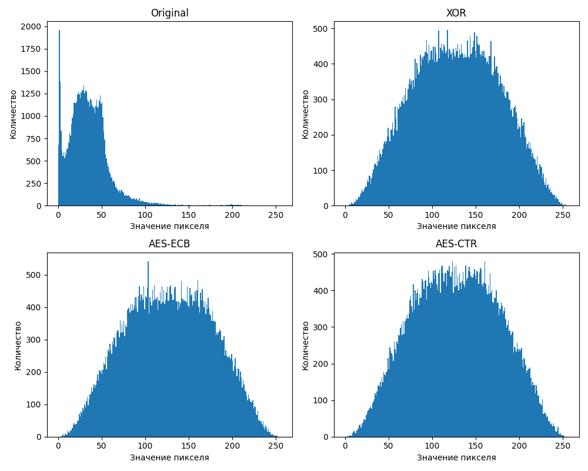

# Отчет по лабораторной работе №1

## 1. Постановка задачи
Написать программы для шифрования изображений: потоковым шифром (XOR) и блочным (AES в режимах ECB и CTR). Сравнить, как методы скрывают данные, посчитав энтропию, корреляцию пикселей и влияние изменения ключа. Для тестов использовать свою картинку `lancer.png` (256x256).

## 2. Реализация
- **XOR:** Использован генератор случайных чисел `xorshift32`. Шифрование и расшифровка работают через обычный побайтовый XOR картинки с выдачей генератора.
- **AES:** Взята стандартная библиотека `cryptography`. Рассмотрено два режима: ECB (базовый, без вектора инициализации) и CTR (со случайным 16-байтным `nonce`).
- **Сохранение данных:** Для CTR-режима `nonce`сохраняется в отдельный файл `results/meta.json`. Сам ключ нигде не сохраняется.
- **Проверка:** Чтобы доказать, что картинка восстанавливается без ошибок, скрипт сравнивает SHA-256 хэши оригинала и расшифрованных файлов.

### 3. Методика эксперимента
- **Выбранное изображение:** Использовалось подготовленное фото `lancer.png` (формат PNG, 256×256).
- **Рассчитываемые метрики:** Считали энтропию Шеннона и корреляцию Пирсона, чтобы понять, насколько зашифрованная картинка стала похожа на случайный шум. Для проверки ключа считали метрики NPCR (сколько байт изменилось) и UACI (насколько сильно они изменились).
- **Корреляция:** Картинка переводилась в черно-белый формат. Сравнивались все соседние пиксели со сдвигом на 1 вправо (по горизонтали) и на 1 вниз (по вертикали).
- **Тест ключа:** Взяли AES-CTR и ключ $K_1$. Зашифровали им картинку. Потом поменяли в ключе ровно один бит (получили $K_2$) и зашифровали картинку еще раз с тем же самым `nonce`. Потом сравнили два результата, чтобы проверить лавинный эффект.

## 4. Результаты
**Проверка обратимости:**
Хэши SHA-256 у оригинала и всех трех расшифрованных картинок полностью совпали. Алгоритмы работают без потери данных.

**Сводная таблица:**

| Метод                 | Энтропия |  Corr H |  Corr V | Особенности                                                 |
| --------------------- | -------: | ------: | ------: | ----------------------------------------------------------- |
| Исходное (lancer.png) |   6.3238 |  0.8943 |  0.8383 | Обычное фото, соседние пиксели сильно похожи                |
| XOR                   |   7.9992 | -0.0023 |  0.0047 | Сплошной шум, связей нет                                    |
| AES-ECB               |   7.9982 |  0.0000 | -0.0000 | Выглядит как шум (т.к. на фото почти нет одинаковых блоков) |
| AES-CTR               |   7.9991 |  0.0032 | -0.0002 | Сплошной шум                                                |

**Чувствительность к изменению ключа (AES-CTR):**
- NPCR: 99.57 %
- UACI: 33.45 %

## 5. Анализ
До шифрования у фото была энтропия 6.32 и высокая корреляция (~0.89), потому что соседние пиксели на фотографиях обычно похожи друг на друга по цвету. 

После шифрования любым из трех методов (XOR, AES-ECB, AES-CTR) энтропия поднялась до ~7.99(максимум для байта 8.0), а корреляция упала до нуля. Это значит, что алгоритмы полностью стерли исходную структуру картинки и превратили её в белый шум. Визуально это тоже подтверждается — картинки выглядят как цветная рябь.

В тесте ключа мы получили NPCR ~99.6% и UACI ~33.4%. Это доказывает наличие строгого лавинного эффекта: если поменять в ключе всего один бит, шифротекст меняется практически целиком.

## 6. Итоговый вывод
Эксперимент показал, что все три алгоритма нормально справляются со скрытием фотографии. Структура картинки разрушается, получается равномерный шум (энтропия максимальна, связи между пикселями пропадают). Режим AES-CTR показал отличную стойкость: малейшее изменение ключа дает совершенно другой результат.