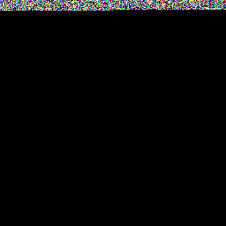
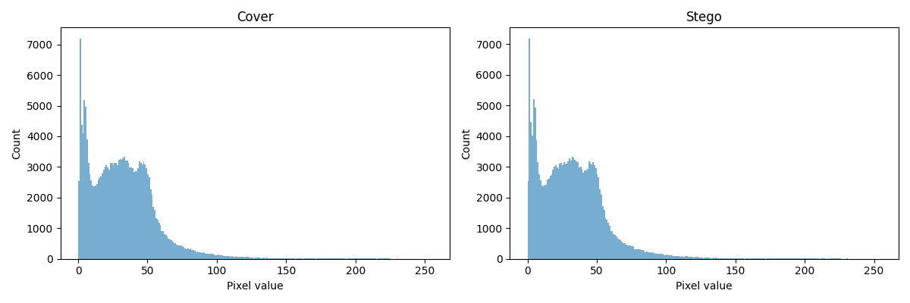

# Отчет по лабораторной работе №2

## 1. Постановка задачи
В работе сравнивались три варианта стеганографии:
- Plain LSB (обычная последовательная замена младшего бита);
- Encrypted LSB (шифрование + последовательная замена);
- Encrypted Random LSB (шифрование + псевдослучайный порядок позиций).
Эксперимент проводился на двух изображениях размером 256x256: фотографии `lancer.png` и синтетическом `gradient.png`. Встраивались два текстовых сообщения: молитва программиста (короткий вариант на ~1% емкости) и она же в расширенном виде (длинный вариант на ~5% емкости).

## 2. Реализация
- **Как выполняется LSB-встраивание:** Текст переводится в массив бит. Скрипт последовательно обходит пиксели и с помощью побитовых операций затирает младший бит цветового канала (RGB), записывая на его место бит сообщения.
- **Хранение длины:** В самое начало встраиваемых данных (до текста) добавляются 4 байта (32 бита), в которых хранится длина сообщения. При извлечении скрипт сначала читает эти байты, чтобы понять, сколько бит нужно вытащить.
- **Проверка вместимости:** Перед встраиванием рассчитывается максимальная емкость: `capacity = width × height × 3` бит. Если длина сообщения + служебные данные больше этой емкости, скрипт выдает ошибку.
- **Шифрование:** Выполняется алгоритмом AES в режиме CTR (библиотека `cryptography`). Ключ (32 байта) генерируется из пароля функцией PBKDF2HMAC (SHA256, 100000 итераций).
- **Служебные данные:** При гибридном методе в файл последовательно сохраняются: 4 байта длины шифротекста, 16 байт случайной соли (salt), 16 байт вектора инициализации (IV/nonce) и сам шифротекст.
- **Случайные позиции:** Псевдослучайный порядок формируется через `random.sample()`, который выбирает уникальные индексы из всех доступных позиций картинки. Чтобы порядок можно было восстановить при извлечении, генератор предварительно инициализируется паролем через `random.seed(password)`.

## 3. Методика эксперимента
- **Объем данных:** Использовались сообщения размером около 150 байт (1200 бит) и 700 байт (5600 бит) вместе со служебными данными.
- **Уровни payload:** Сравнивались заполнения на ~1% и ~5% от максимальной емкости изображений.
- **Метрики:** Для оценки искажений рассчитывались PSNR и SSIM. Для статистического анализа — доля измененных компонент (Changed Ratio), вероятность появления единицы в младшем бите P(LSB=1) и p-value по критерию χ².
- **Изображения:** Основной эксперимент проводился на реальном фото `lancer.png` и градиенте `gradient.png`.

## 4. Результаты

Таблица для фото `lancer.png`:

| Method | Заполнение | PSNR | SSIM | Changed Ratio | P(LSB=1) | χ² p-value |
|---|---:|---:|---:|---:|---:|---:|
| Plain LSB | 1% | 71.5583 | 0.999993 | 0.007919 | 0.506841 | 0 |
| Encrypted LSB | 1% | 70.8757 | 0.999990 | 0.009033 | 0.507187 | 0 |
| Random LSB | 1% | 71.1501 | 0.999967 | 0.014938 | 0.506953 | 0 |
| Plain LSB | 5% | 64.6283 | 0.999893 | 0.039474 | 0.504740 | 0 |
| Encrypted LSB | 5% | 64.5424 | 0.999884 | 0.040100 | 0.507222 | 0 |
| Random LSB | 5% | 64.4289 | 0.999844 | 0.068817 | 0.506749 | 0 |

Таблица для `gradient.png`:

| Method | Заполнение | PSNR | SSIM | Changed Ratio | P(LSB=1) | χ² p-value |
|---|---:|---:|---:|---:|---:|---:|
| Plain LSB | 1% | 77.9071 | 0.999996 | 0.002087 | 0.462845 | 0 |
| Encrypted LSB | 1% | 76.7976 | 0.999993 | 0.002281 | 0.463141 | 0 |
| Random LSB | 1% | 76.9972 | 0.999979 | 0.003887 | 0.462282 | 0 |
| Plain LSB | 5% | 70.8549 | 0.999930 | 0.010025 | 0.463834 | 0 |
| Encrypted LSB | 5% | 70.4598 | 0.999916 | 0.010185 | 0.464526 | 0 |
| Random LSB | 5% | 70.5873 | 0.999907 | 0.016941 | 0.462584 | 0 |

## 5. Анализ
- **PSNR и SSIM:** Значения PSNR везде высокие (выше 64 дБ), а SSIM держится на уровне 0.999. Это показывает, что визуальной разницы между оригиналом и stego-файлами нет. Шифрование и рандомизация позиций незначительно снижают PSNR, но визуально это неразличимо.
- **Доля измененных компонент:** Ожидаемо растет при увеличении объема встраиваемых данных. Для случайного размещения (Random LSB) эта доля часто получается чуть выше, так как биты распределяются по всему изображению, а не кучно.
- **Распределение LSB:** При встраивании зашифрованных данных или большого объема текста вероятность появления единицы в младшем бите `P(LSB=1)` начинает стремиться к 0.5 (равномерное распределение), так как зашифрованные данные выглядят как белый шум.
- **χ² и p-value:** В тестах p-value равен нулю. Поскольку замеряется максимум 5% емкости изображения, базовая статистическая структура пар пикселей сохраняется достаточно хорошо, чтобы стандартный глобальный χ²-тест не мог зафиксировать статистически значимую аномалию.
- **Влияние шифрования:** Шифрование делает встраиваемые биты хаотичными, предотвращая сигнатурный анализ, но на визуальную заметность (метрик PSNR/SSIM) влияет минимально.
- **Псевдослучайное размещение:** Размазывает изменения по всей площади картинки. Это отлично видно на карте разности: в отличие от Plain LSB, где измененные пиксели скапливаются в верхних строках, Random LSB не создает кучных визуальных дефектов.
- **Влияние payload:** Рост объема текста с 1% до 5% увеличивает долю искаженных пикселей (с ~1% до ~4-6%) и снижает PSNR, однако искажения по-прежнему остаются за пределами человеческого зрения.

## 6. Итоговый вывод
Эксперимент показал, что LSB-встраивание позволяет незаметно скрывать информацию (до 5% емкости) без видимых визуальных артефактов (PSNR > 57). Статистически, увеличение payload и использование шифрования сдвигают распределение младших битов к 0.5. Применение шифрования в сочетании с псевдослучайным размещением является оптимальным методом: оно сохраняет высокую визуальную незаметность, но критически усложняет обнаружение и извлечение данных методами классического стегоанализа.